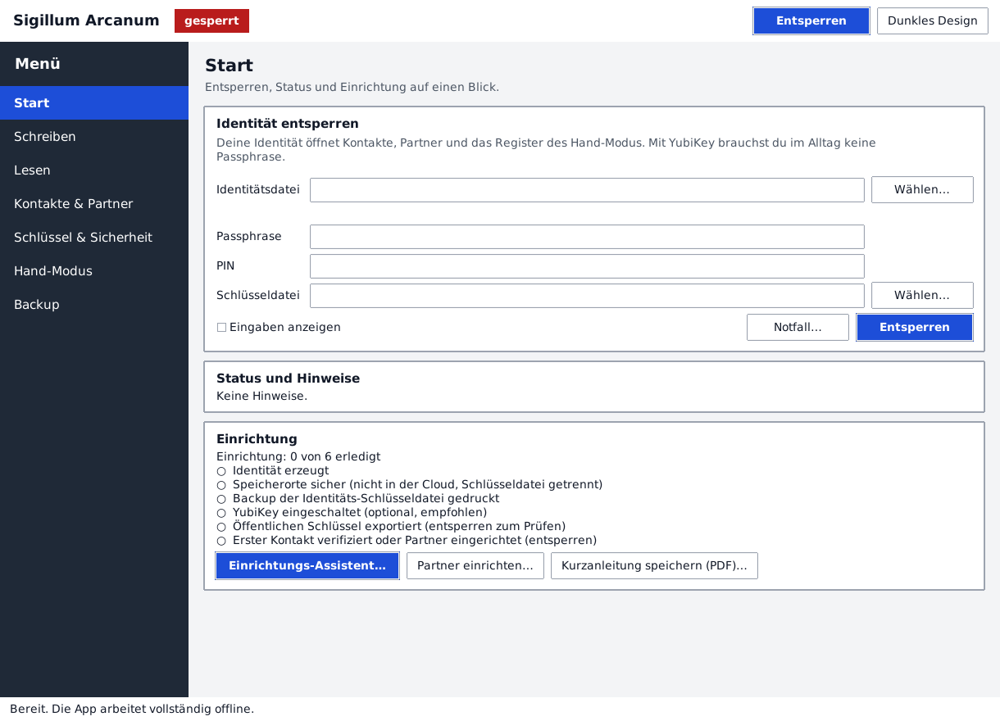
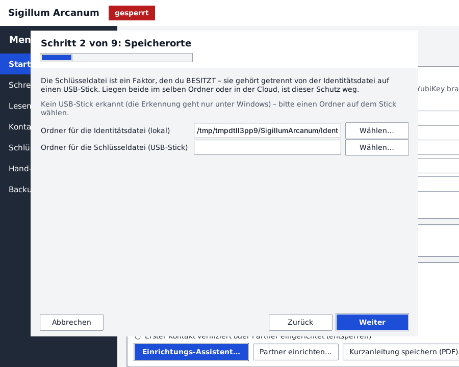
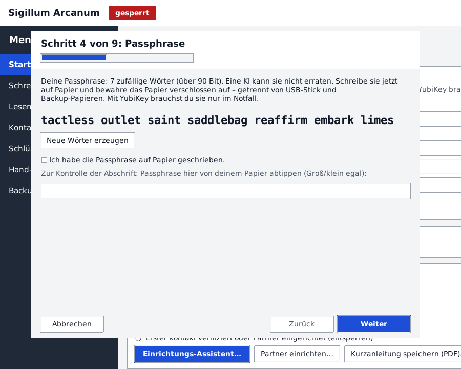
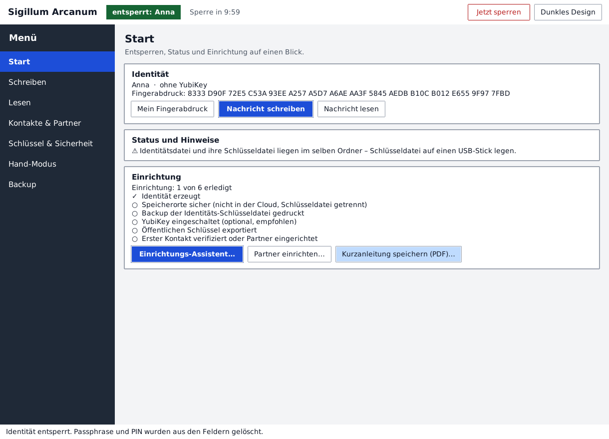
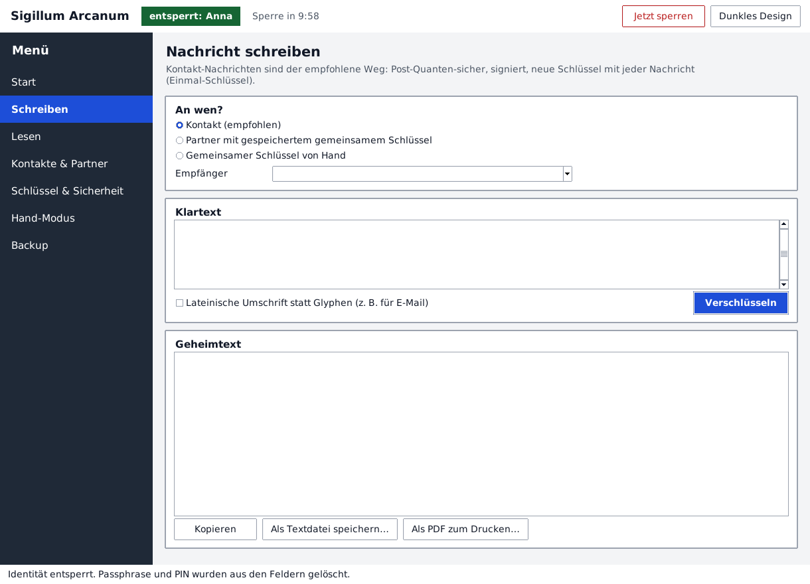
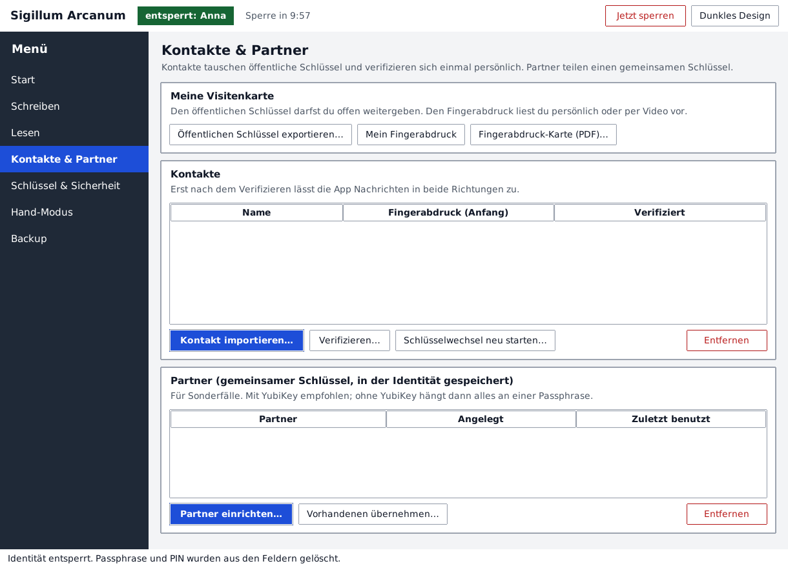
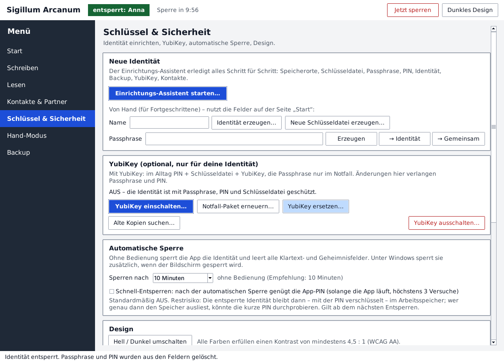
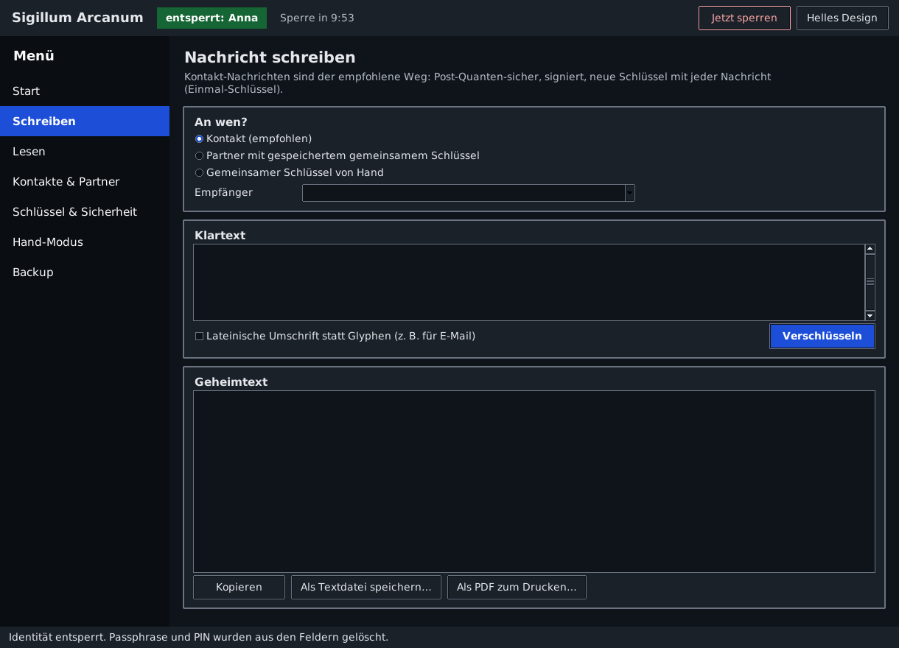

# Sigillum Arcanum – Version 11.2

Verschlüsselung mit eigener Schrift. Läuft vollständig offline unter Windows.

Diese Anleitung führt Schritt für Schritt durch Einrichtung, Alltag und Notfall. Wer nur das Nötigste will: Abschnitt
„Ersteinrichtung“ lesen, den Assistenten starten, fertig. Eine einseitige **Kurzanleitung** zum Ausdrucken erzeugt die
App selbst (Seite „Start“ → „Kurzanleitung speichern“). Die Bilder unten stammen aus einer Testumgebung; unter Windows
sieht die Schrift etwas anders aus.

**Neu in Version 11**
* **Einrichtungs-Assistent**: führt durch Speicherorte, Schlüsseldatei, Passphrase, PIN, Identität, Backup, YubiKey
  und Kontakte.
* **Mit YubiKey keine Passphrase im Alltag**: PIN + Schlüsseldatei + YubiKey genügen. Die Passphrase wird nur noch im
  Notfall und für Änderungen am YubiKey-Schutz gebraucht.
* **Automatische Sperre** nach 10 Minuten ohne Bedienung (einstellbar), optional **Schnell-Entsperren** mit der PIN.
* **Partner**: gemeinsame Schlüssel verschlüsselt in der Identität speichern – senden heißt dann nur noch „Partner
  wählen“.
* **Neue Oberfläche**: Navigation links, klare Kontraste (mindestens 4,5 : 1), helles und dunkles Design.
* **Warnungen** bei Schlüsseldateien in OneDrive/Dropbox oder im selben Ordner wie die Identitätsdatei.
* App-PIN jetzt **mindestens 6 Zeichen** (BSI TR-02102-1).

**Neu in Version 11.2 (nach der 11. Prüfrunde)**
* **Einmal-Schlüssel je Nachricht:** Jede Kontakt-Nachricht kündigt 5 neue Empfangsschlüssel an. Schreibt dir ein
  Kontakt mehrmals, ohne dass du antwortest, bekommen die ersten 4 Nachrichten je einen eigenen Schlüssel, der nach
  dem Lesen gelöscht wird. Erst ab der 5. Nachricht bis zu deiner Antwort geht alles an denselben Rückfallschlüssel –
  die App weist beim Schreiben darauf hin. Kontakt-Nachrichten sind dadurch größer (etwa 25.000 Zeichen statt 14.000).
  **Beide Seiten brauchen 11.2**: Nachrichten aus 11.1 werden weiter gelesen, 11.1 kann Nachrichten aus 11.2 nicht lesen.
* **Passphrasen:** Es zählen nur verschiedene Wörter (mindestens 6); eine neue Identität von Hand nur mit einer in
  der App gewürfelten Passphrase („Erzeugen“). Bei einer von außen eingetippten Passphrase (Partner, gemeinsamer
  Schlüssel) fragt die App einmal nach, ob sie aus einer App bzw. vom Übergabeblatt stammt. Ältere Partner mit
  schwacher Passphrase öffnen weiter; die Startseite empfiehlt, sie neu einzurichten.
* **App-PIN:** naheliegende PINs werden für neue Identitäten abgelehnt – nur ein oder zwei verschiedene Zeichen,
  Zahlen- und Tastenfolgen (auch Ziffernblock-Wege und 1q2w3e), kurze Wiederholungen, Spiegelmuster, Datumsangaben
  (auch mit Punkten), häufige Wörter. Der Assistent schlägt auf Wunsch eine zufällige 8-stellige PIN vor. Bei
  bestehenden Identitäten zeigt die Startseite nur einen Hinweis.
* **YubiKey:** Passkeys, die in eine Cloud gesichert werden (Handy, iCloud, Google, Passwortmanager), werden abgelehnt.
* **Zurückgespielte ältere Identitätsdatei** wird erkannt (auf diesem Rechner) und nur nach Rückfrage geöffnet.
* **Zwischenablage:** Steht beim Sperren Klartext darin, wird sie geleert.
* Selbsttest mit Prüfwerten fremder Implementierungen (ECDSA, ML-DSA-87, Argon2id); pip 26.3.

**Version 11 ist mit früheren Versionen nicht kompatibel.** Identitäten aus Version 10/10.1 bitte neu erzeugen
(ältere Dateien werden mit einer klaren Meldung abgelehnt).

| Version | Inhalt |
| --- | --- |
| 4–9 | Sicherheitsprüfungen 1–7, YubiKey und Notfall-Paket (Version 7) |
| 10 | BSI-TR-02102-1-Umbau: ML-KEM-1024 + brainpoolP512r1, ML-DSA-87 + ECDSA, AES-256-GCM-SIV, SHA-3, Shamir über Primkörper, Selbsttest beim Start |
| 10.1 | Befunde der 8. Prüfung behoben: Backup erkennt einen verfälschten Teil, kanonische ECDSA-Signaturen, saubere Meldung bei zu kurzen Dateien |
| 11 | Assistenten, Alltag ohne Passphrase (mit YubiKey), automatische Sperre, Schnell-Entsperren, Partner in der Identität, neue Oberfläche, Cloud-Warnungen |
| 11.1 | Härtung nach der 9. Prüfung: zusätzlicher Prüfwert für den Alltags-Schlüssel, Partner-Einträge werden beim Laden wie beim Anlegen geprüft. Identitäten aus 11 öffnen unverändert. Knopf oben rechts wechselt zwischen „Entsperren“ und „Jetzt sperren“ |
| 11.2 | Befunde der 11. Prüfung behoben: Einmal-Schlüssel je Nachricht (Modus 6), strengere Passphrase- und PIN-Regeln, Cloud-Passkeys abgelehnt, Warnung bei älterer Identitätsdatei, Zwischenablage, Fremd-Prüfwerte im Selbsttest |

---

## 1. Installation (einmalig)

1. Python 3.11 oder neuer installieren (empfohlen: aktuelle 3.13 oder 3.14): <https://www.python.org/downloads/windows/>
2. `installieren.bat` doppelklicken. Das Skript
   * prüft die Python-Version,
   * bringt zuerst `pip` selbst auf eine geprüfte Version,
   * installiert alle Bibliotheken in festen Versionen, jede per SHA-256-Prüfsumme kontrolliert, nur als fertige
     Pakete (kein Ausführen fremder Installationsskripte).
3. Starten mit `start.bat`. Beim Start prüft die App alle Verfahren gegen feste Bekannt-Antwort-Werte; rechnet eine
   Bibliothek falsch, startet sie nicht.

Bei einem Update: `installieren.bat` erneut ausführen.

## 2. Was liegt wo?

| Was | Wohin | Warum |
| --- | --- | --- |
| Schlüsseldatei der Identität (`.sakey`) | **USB-Stick** | Faktor „Besitz“ – getrennt von der Identitätsdatei |
| Identitätsdatei (`.said`) | **lokaler Ordner**, z. B. `%LOCALAPPDATA%\SigillumArcanum\Identitaet` | Cloud-Dienste behalten alte Versionen mit gelöschten Schlüsseln |
| Passphrase (7 Wörter) | **Papier**, verschlossen | mit YubiKey nur für Notfall und Änderungen |
| App-PIN (≥ 6 Zeichen) | im Kopf | bei jedem Entsperren |
| YubiKey + FIDO2-PIN | am Schlüsselbund / im Kopf | optional, empfohlen |
| Backup der Schlüsseldatei | **3 Papiere an 3 Orten** | 2 genügen, eines allein verrät nichts |
| Notfall-Paket (nur mit YubiKey) | **3 Papiere an 3 Orten** | Ersatz, wenn der YubiKey fehlt |
| Öffentlicher Schlüssel (`.sapub`), Fingerabdruck-Karte | beliebig | nicht geheim |

**Nie** in OneDrive, Dropbox, Google Drive oder Ähnliches: Schlüsseldateien, Identitätsdatei, Backup-Teile.
Die App erkennt solche Ordner und warnt. **Nie** zusammen aufbewahren: Passphrase und Backup-/Notfall-Papiere.

## 3. Ersteinrichtung mit dem Assistenten

Beim ersten Start bietet die App den Assistenten an; später: Seite „Start“ → „Einrichtungs-Assistent…“.
Du brauchst etwa 15 Minuten, einen USB-Stick, einen **lokalen** Drucker (kein Netzwerk-/Cloud-Drucker) und Papier.



1. **Speicherorte.** Ordner für die Identitätsdatei (lokal, vorgeschlagen) und für die Schlüsseldatei (USB-Stick; die
   App zeigt erkannte Sticks). Gleicher Ordner wird abgelehnt, Cloud-Ordner und gleiches Laufwerk werden nachgefragt.

   
2. **Name und Schlüsseldatei.** Dein Name für Kontakte. Die App erzeugt die Schlüsseldatei direkt auf dem Stick und
   überschreibt nie etwas.
3. **Passphrase.** Die App zeigt 7 zufällige Wörter. Auf Papier schreiben, Häkchen setzen, vom Papier abtippen – so
   ist sicher, dass die Abschrift stimmt. Andere Wörter? „Neue Wörter erzeugen“.

   
4. **App-PIN.** Mindestens 6 Zeichen, zweimal eingeben. Empfohlen: 6 oder mehr zufällige Ziffern; nicht die
   YubiKey-PIN. Naheliegende PINs (Datum, 123456, 121212, lauter gleiche Zeichen …) lehnt die App ab. Wer einen
   YubiKey nutzt, nimmt besser 8 oder mehr (siehe Abschnitt 10).
5. **Identität erzeugen.** Dauert einige Sekunden. Danach ist sie entsperrt.
6. **Backup drucken.** 3 PDFs erscheinen in einem Ordner nur zum Drucken; nach deiner Bestätigung löscht die App sie.
   Optional jeden Teil zusätzlich als Datei, jeder in einem **eigenen** Ordner. Ohne Backup erinnert die Startseite.
7. **YubiKey (optional).** Vorher im Yubico Authenticator eine FIDO2-PIN setzen (6 zufällige Ziffern empfohlen).
   „YubiKey jetzt einschalten“: Im Windows-Dialog **„Sicherheitsschlüssel“** wählen (nicht Windows Hello, nicht
   Smartphone), PIN eingeben, antippen – zweimal. Dann druckt die App das **Notfall-Paket** (3 Papiere).
8. **Kontakte vorbereiten.** Öffentlichen Schlüssel exportieren, Fingerabdruck-Karte und Kurzanleitung speichern.

Danach zeigt die Startseite eine Checkliste („Einrichtung x von 6 erledigt“) und alle offenen Hinweise.

## 4. Alltag

**Entsperren** (Seite „Start“): Identitätsdatei, PIN, Schlüsseldatei – die Pfade merkt sich die App, nie Geheimnisse.
* **Mit YubiKey:** Das Passphrase-Feld verschwindet. PIN eingeben, „Entsperren“, dann FIDO2-PIN und antippen.
* **Ohne YubiKey:** zusätzlich die Passphrase – einmal pro Sitzung.



**Automatische Sperre:** Nach 10 Minuten ohne Bedienung (einstellbar 5–30, Seite „Schlüssel & Sicherheit“) sperrt
die App, leert alle Klartext- und Geheimnisfelder und schließt offene Assistenten und Dialoge. Oben rechts steht die
Restzeit. Der Knopf oben rechts wechselt mit dem Zustand: entsperrt heißt er „Jetzt sperren“ (sperrt sofort und leert
ebenfalls alles), gesperrt „Entsperren“ bzw. „Mit PIN fortsetzen“ – er führt zur Seite „Start“ und setzt den Cursor
in das Feld, das als Nächstes gebraucht wird.
Unter Windows sperrt sie zusätzlich, wenn der Bildschirm gesperrt wird.

**Schnell-Entsperren (optional, standardmäßig aus):** Wirkt ab dem nächsten Entsperren nach dem Einschalten (erst
dann kennt die App die PIN). Nach der *automatischen* Sperre genügt die App-PIN, solange
die App läuft. Nach 3 falschen PINs, nach „Jetzt sperren“, nach dem Schließen oder wenn die Identitätsdatei von außen
geändert wurde, gilt wieder der normale Weg. Restrisiko: Die Sitzung liegt dann – mit der PIN verschlüsselt – im
Arbeitsspeicher; wer genau dann den Speicher ausliest, könnte die kurze PIN durchprobieren.

**Schreiben** (Seite „Schreiben“): Empfänger wählen, Text eingeben, „Verschlüsseln“, dann kopieren, als Text oder
PDF speichern.
* **Kontakt (empfohlen):** Post-Quanten-sicher, signiert. Jede Nachricht kündigt neue Schlüssel an; bis zu 4
  Nachrichten in Folge ohne Antwort gehen an je einen eigenen Einmal-Schlüssel, danach bis zur Antwort an denselben
  Rückfallschlüssel (Hinweis in der Statuszeile).
* **Partner:** gemeinsamer Schlüssel aus deiner Identität (Abschnitt 6).
* **Gemeinsamer Schlüssel von Hand:** Passphrase, PIN und Schlüsseldatei eintippen.



**Lesen** (Seite „Lesen“): Geheimtext einfügen – mehrere Nachrichten durch eine Leerzeile getrennt, die App sortiert
sie. Für gemeinsame Nachrichten oben den Partner wählen (oder „Von Hand“).

## 5. Kontakt hinzufügen und verifizieren

1. Seite „Kontakte & Partner“ → „Öffentlichen Schlüssel exportieren“; die `.sapub`-Datei austauschen (darf offen
   verschickt werden).
2. „Kontakt importieren…“. Gibt es schon einen ähnlich heißenden Kontakt, warnt die App.
3. „Verifizieren…“: Triff die Person **persönlich oder per Video** und stelle eine Frage, die nur ihr beide
   beantworten könnt. Ein Telefonanruf reicht nicht – Stimmen lassen sich mit KI fälschen. Die Person liest ihren
   Fingerabdruck vor (64 Zeichen, auch von der Fingerabdruck-Karte), du tippst ihn vollständig ein.
4. Erst dann lässt die App Nachrichten in beide Richtungen zu.



**Schlüsselwechsel:** Jede Nachricht kündigt 5 neue Empfangsschlüssel an – 4 Einmal-Schlüssel und einen
Rückfallschlüssel. Ein Einmal-Schlüssel wird gelöscht, sobald die Nachricht an ihn geöffnet ist; ältere Schlüssel
werden gelöscht, sobald der Partner einen neueren benutzt. Alte Nachrichten sind danach auch für dich nicht mehr
lesbar – gewollt. Eine zweite Kopie einer schon geöffneten Nachricht erkennt die App („schon geöffnet“), zeigt den
Inhalt aber nicht noch einmal. Fehlt eine ältere Nachricht, fragt sie, bevor
sie etwas löscht. Nach dem Einspielen eines alten Backups: beim Kontakt „Schlüsselwechsel neu starten“.

## 6. Partner mit gemeinsamem Schlüssel

Für regelmäßigen Austausch sind Kontakt-Nachrichten sicherer. Ein gemeinsamer Schlüssel ist für Sonderfälle gedacht,
z. B. einen Partner ohne eigene Identität.

**Partner einrichten** („Kontakte & Partner“ → „Partner einrichten…“):
1. Name des Partners.
2. Die App erzeugt Schlüsseldatei, Passphrase (7 Wörter) und PIN (6 Ziffern).
3. Schlüsseldatei auf den USB-Stick des Partners speichern.
4. Übergabeblatt (Passphrase + PIN) drucken – das PDF wird danach gelöscht. Blatt und Stick persönlich übergeben.
5. Deine Kopie: **in deiner Identität speichern** (mit YubiKey empfohlen) oder als eigene Schlüsseldatei. Ohne
   YubiKey weist die App darauf hin, dass dann alles an einer Passphrase hängt.

**Vorhandenen Schlüssel übernehmen** („Vorhandenen übernehmen…“): Name, Schlüsseldatei, Passphrase, PIN eintragen.
Danach bietet die App an, die lose Schlüsseldatei zu überschreiben und zu löschen (in der Cloud bitte Versionen und
Papierkorb selbst leeren). Die Faktoren eines gemeinsamen Schlüssels dürfen nie die deiner Identität sein – die App
lehnt das ab. Dein Partner kann deine Identität nicht öffnen.

## 7. YubiKey



* **Einschalten / Notfall-Paket erneuern / Key ersetzen / Ausschalten** (Seite „Schlüssel & Sicherheit“): Jede dieser
  Änderungen verlangt **Passphrase und PIN** (Schritt-Bestätigung). Danach entsteht immer ein neues Notfall-Paket; alte
  Papiere vernichten.
* **Alte Kopien suchen…** findet Kopien dieser Identitätsdatei am Dateikopf (auch auf USB-Sticks) und löscht auf
  Wunsch die schwächer geschützten. Versionsverläufe (OneDrive, Dateiversionsverlauf) bitte selbst bereinigen.
* Den YubiKey abziehen, wenn er nicht gebraucht wird. Nach 8 falschen FIDO-PINs sperrt er sich (das BSI empfiehlt 3 –
  beim YubiKey nicht einstellbar).
* Den YubiKey **nie zurücksetzen**, nur weil eine PIN-Abfrage abgebrochen wurde – das löscht den Zugang.
* YubiKeys mit Firmware **vor 5.7** sind von **YSA-2024-03** betroffen (Klonen mit Laborausrüstung; Key UND FIDO-PIN
  nötig). Die übrigen Faktoren schützen weiter.
* Unter Windows nutzt die App die Windows-Sicherheitsabfrage für die PIN; Administratorrechte sind nicht nötig.

## 8. Notfall

**YubiKey verloren, defekt oder gesperrt:** Seite „Start“ → Identitätsdatei wählen → „Notfall…“ → im Fenster
Passphrase und App-PIN eintragen und zwei (besser drei) Teile des Notfall-Pakets einfügen oder öffnen. Mit drei Teilen erkennt die App einen
verfälschten Teil; ein unlesbarer Teil (Tippfehler) muss korrigiert oder weggelassen werden. Danach verlangt die App
**sofort ein neues Notfall-Paket**: bisherigen Key behalten, neuen Key einrichten oder YubiKey ausschalten. Brichst du
ab oder stürzt die App ab, verlangt sie die Erneuerung beim nächsten Entsperren.

**Schlüsseldatei verloren:** Seite „Backup“ → zwei (besser alle drei) Teile eingeben → „Wiederherstellen und
speichern…“. Mit drei Teilen erkennt die App einen falsch abgetippten oder verfälschten Teil und nennt ihn. Teile
eines Notfall-Pakets gehen hier auch (dann wird die Identitäts-Schlüsseldatei wiederhergestellt).

## 9. Hand-Modus

* „Zufallsblatt erzeugen“: zwei identische Exemplare (Absender, Empfänger). Das PDF liegt nur zum Drucken in einem
  Ordner und wird danach gelöscht.
* „Referenzkarte + Tafeln“: Werte-Tabelle, Ablauf, XOR-Tafel und Mal-Tafel.
* Von Hand: Klartext in Werte; davor die Blockzahl; Geheimwert = Klartext XOR V; vier Prüfwerte mit der Mal-Tafel.
  Beim Entschlüsseln die Prüfwerte nachrechnen – weicht einer ab, Nachricht verwerfen.
* Schutz: Inhalt beweisbar perfekt geheim; unbemerkte Fälschung gelingt nur mit 1 : 1.048.576.
* Jedes Blatt **genau einmal – für eine Nachricht in eine Richtung**. Die Rechenhilfe merkt sich benutzte Blätter
  verschlüsselt in der Identität und verweigert ein zweites Mal.

## 10. Was geschützt ist – und was nicht

Geschützt: Inhalt, Echtheit, Unverändertheit, Absender und Empfänger im Geheimtext, grobe Länge. Gegen KI und
Quantencomputer nach heutigem Stand sicher (siehe `docs/SECURITY-REVIEW.md`). Die Post-Quanten-Verfahren werden – wie vom BSI
empfohlen – nur in Kombination mit klassischen Verfahren eingesetzt.

Nicht geschützt bzw. Restrisiken:
* **Schadsoftware auf dem Rechner** sieht Klartext und Schlüssel, auch mit YubiKey. Größtes Risiko.
  Zwischenablage-Verlauf (Win+V) abschalten, Klartext nie kopieren (beim Sperren leert die App die Zwischenablage,
  wenn Klartext darin steht – der Windows-Verlauf behält ihn trotzdem).
* **Mit YubiKey ruht der Alltag auf der App-PIN:** Wer Schlüsseldatei, Identitätsdatei, deinen YubiKey UND dessen
  FIDO-PIN hat, kann die App-PIN auf eigener Hardware durchprobieren (gebremst durch Argon2id, 1 GiB). Deshalb: App-PIN
  mit 8 oder mehr Zeichen, YubiKey und Stick nicht gemeinsam verlieren; bei Verlust des Keys sofort „YubiKey
  ersetzen“.
* **Transport-Metadaten**: Wer wann etwas verschickt, sieht der Übertragungsweg.
* **Lokale Einstellungen** (`%APPDATA%\SigillumArcanum\einstellungen.json`) enthalten nichts Geheimes, aber die zuletzt
  benutzten **Pfade** (wo Identität und Schlüsseldatei liegen). Wer den Rechner kontrolliert, kann Warnungen abschalten.
* **Gelöschte Daten auf SSDs** können eine Zeit lang wiederherstellbar sein – BitLocker nutzen.
* **Erste Nachricht** an einen Kontakt geht an seinen festen Basis-Schlüssel (nicht vorwärts-sicher). Ab der 5.
  Nachricht in Folge ohne deine Antwort geht alles an denselben Rückfallschlüssel; wer danach deine Identität samt
  Faktoren erbeutet, kann noch **ungelesene** und an den Rückfallschlüssel gerichtete Nachrichten öffnen.
* **Eine schon geöffnete Kontakt-Nachricht** lässt sich nicht noch einmal anzeigen (ihr Einmal-Schlüssel ist gelöscht).
  Klartext bei Bedarf selbst sicher aufbewahren.
* **Arbeitsspeicher**: Python kann Schlüssel nicht garantiert löschen. **Sperren schützt die Bedienung, nicht den
  Speicher** – auch nach dem Sperren können Schlüssel und Passphrase noch im Arbeitsspeicher stehen und z. B. über
  die Ruhezustandsdatei (hiberfil.sys) oder ein Absturzabbild auslesbar sein. Schnell-Entsperren hält die Sitzung
  zusätzlich mit der PIN verschlüsselt im Speicher. Deshalb: App nach Gebrauch **schließen**, BitLocker nutzen.
* **Zurückgespielte ältere Identitätsdatei**: Die App erkennt das nur auf dem Rechner, auf dem die neuere Fassung
  benutzt wurde (Zähler in den lokalen Einstellungen); auf einem anderen Rechner nicht. Wer die lokalen Einstellungen
  ändern kann, kann die Warnung unterdrücken. Der Zähler dort zeigt, wie oft die Datei gespeichert wurde.
* **Alte Fassungen der Identitätsdatei** (Cloud-Versionen, Dateiversionsverlauf, Backups, gelöschte Kopien auf SSDs)
  enthalten noch die damals offenen Schlüssel. Mit deren Faktoren lassen sich die damals ungelesenen Nachrichten
  öffnen. Versionsverläufe deshalb ausschalten bzw. bereinigen.
* **YubiKey-Dialog von Windows**: Passkeys mit Cloud-Sicherung werden abgelehnt; ein Gerät, das sich fälschlich als
  nicht sicherbar meldet, kann die App nicht erkennen. Im Dialog immer „Sicherheitsschlüssel“ wählen.
* Der Empfänger einer Kontakt-Nachricht kann Dritten beweisen, dass sie von dir stammt.
* **Partner in der Identität**: Wer deine Identität öffnet, hat auch die gemeinsamen Schlüssel.
* **Menschliche Fehler** (Papiere zusammen lagern, alte Kopien behalten, Blätter doppelt benutzen): Die App warnt,
  kann es aber nicht vollständig verhindern.
* Die automatische Sperre bei gesperrtem Windows-Bildschirm wurde nur außerhalb von Windows getestet.
* Der Code ist **nicht unabhängig auditiert**. Format-Beschreibung: `FORMAT.md`.



## 11. Tests

```
.venv\Scripts\python -m pip install pytest
.venv\Scripts\python -m pytest tests
.venv\Scripts\python tests\manual_gui_e2e.py      (öffnet kurz ein Fenster, prüft die bisherigen Abläufe)
.venv\Scripts\python tests\manual_gui_v11.py      (öffnet kurz ein Fenster, prüft Assistent, Sperre, Partner)
```

Die automatischen Tests nutzen für den YubiKey eine Software-Nachbildung (`tests/softtoken.py`). Der Test mit dem
echten YubiKey geschieht von Hand: Assistent mit YubiKey, zweimal entsperren (ohne Passphrase), Notfall, Key ersetzen,
ausschalten.

## 12. Lizenzen und Normen

* Wortliste: EFF Large Wordlist, © Electronic Frontier Foundation, unter Creative Commons Attribution
  (CC BY 4.0 laut <https://www.eff.org/copyright>); unverändert übernommen.
* Eigene Schrift (`sigillum/fonts/`), Code und Dokumentation: Apache-2.0 (siehe `LICENSE` und `NOTICE`).
* Bibliotheken: cryptography (Apache-2.0/BSD), PyNaCl/libsodium (Apache-2.0/ISC), ReportLab (BSD),
  python-fido2 (Yubico, BSD-2-Clause / Apache-2.0 / MPL-2.0).
* Normen: FIPS 203 (ML-KEM), FIPS 204 (ML-DSA), NIST SP 800-227 (Hybrid-Kombinierer), RFC 8452 (AES-GCM-SIV),
  RFC 5869 (HKDF), RFC 5639 (Brainpool-Kurven), BSI TR-02102-1, WCAG 2.x (Kontrast).
* Eigener Bekannt-Antwort-Test für den Hybrid-Schlüsselaustausch in `tests/vectors/hkem_v3.txt`.
