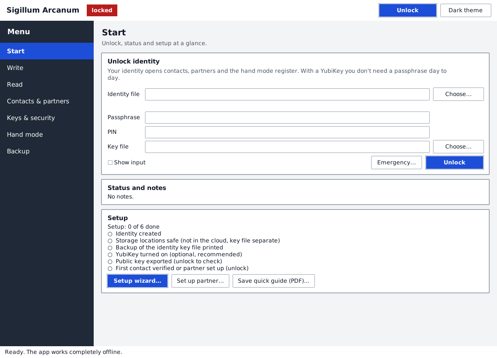
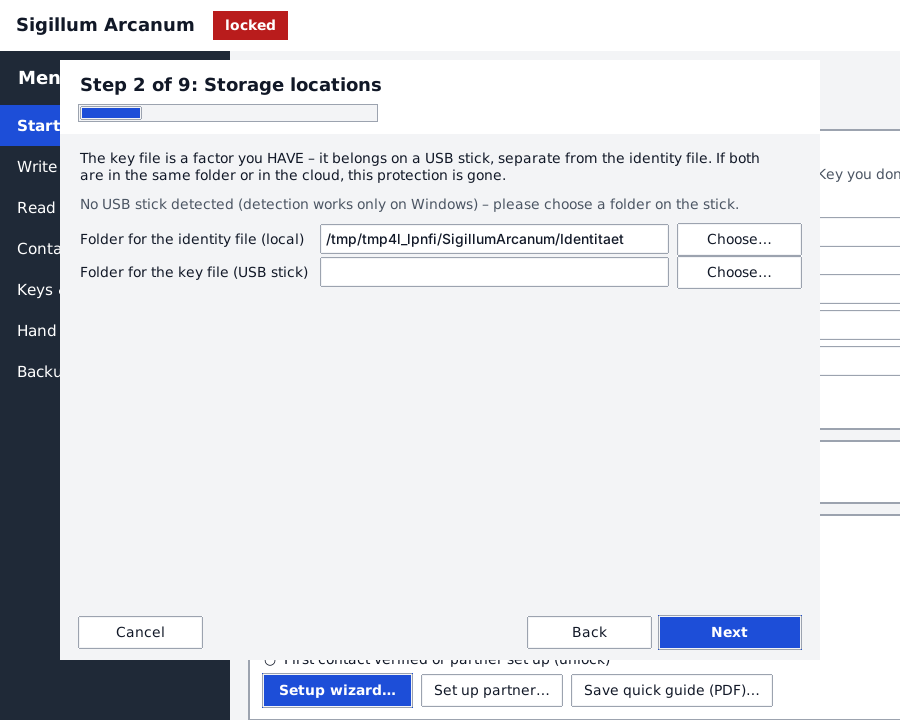
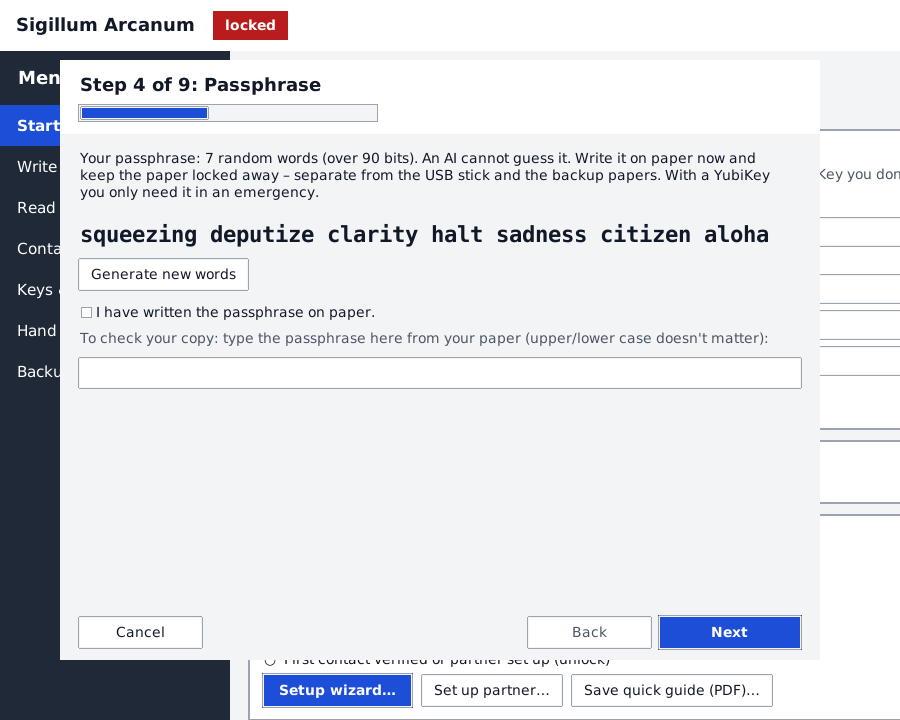
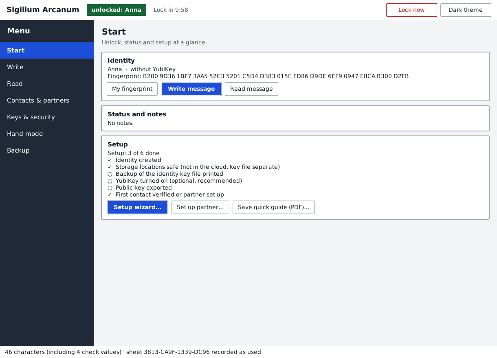
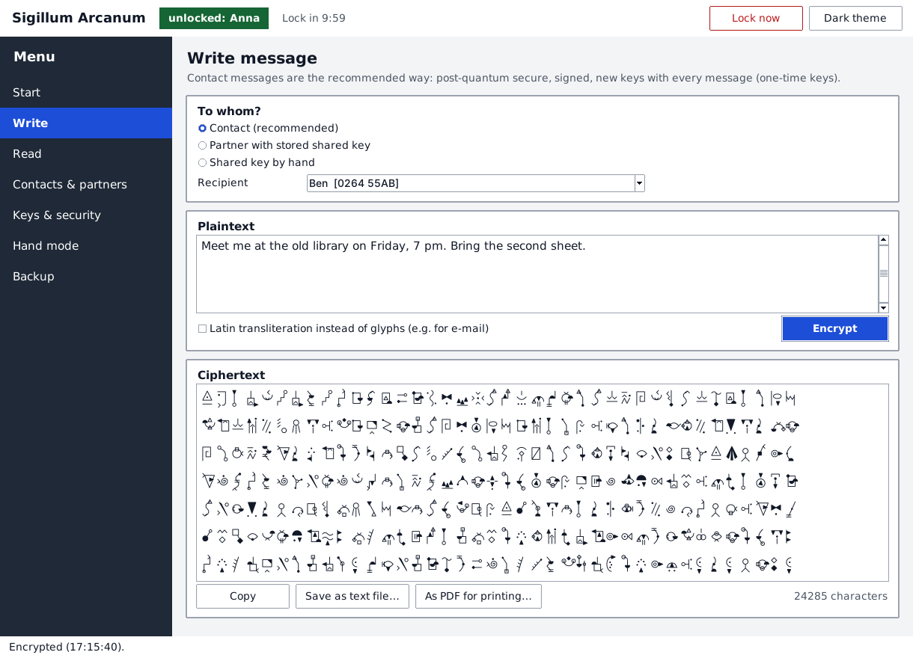
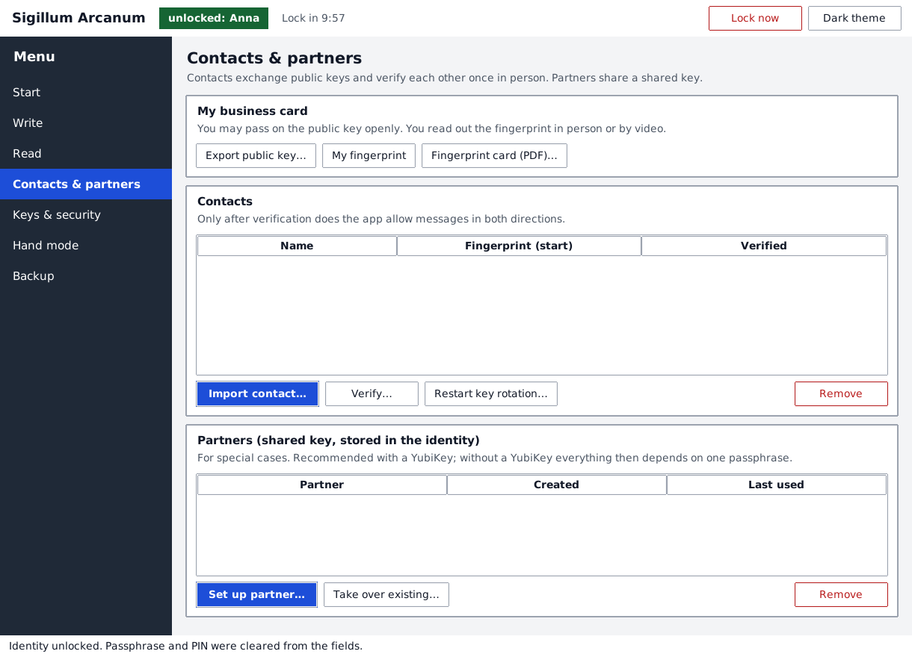
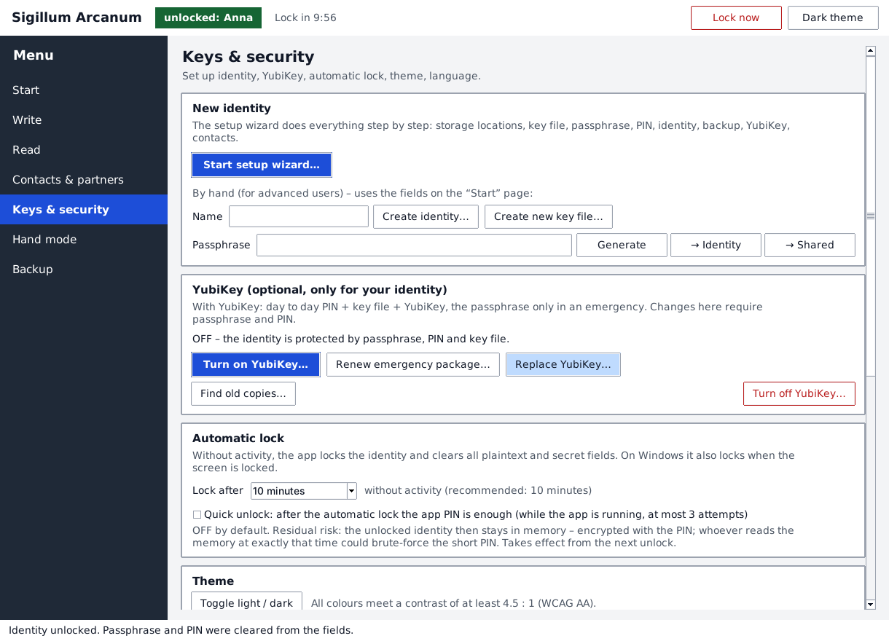
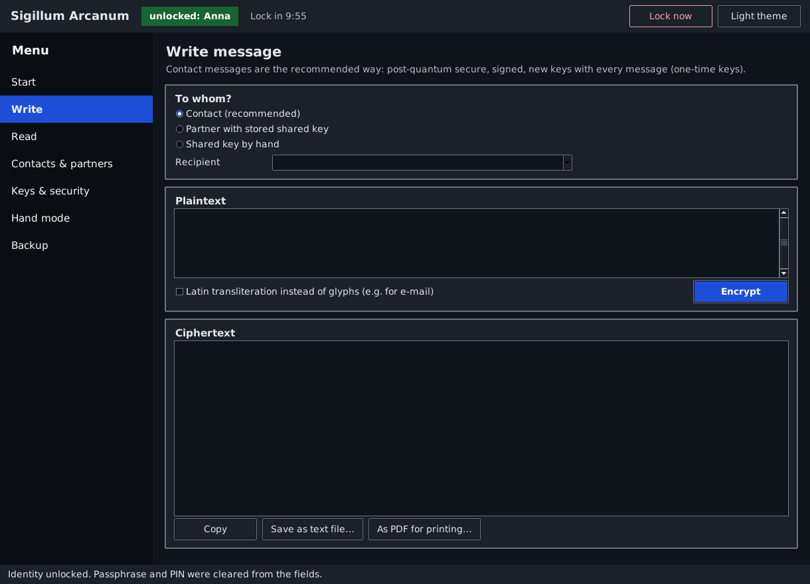

# Sigillum Arcanum – Version 11.4

*Deutsche Anleitung: [`LIESMICH.md`](LIESMICH.md)*

Encryption with its own script. Runs completely offline on Windows.

This manual walks you step by step through setup, everyday use and emergencies. If you only want the essentials:
read “First-time setup”, start the wizard, done. The app itself creates a one-page **quick guide** for printing
(“Start” page → “Save quick guide (PDF)…”). The screenshots below come from a test environment; on Windows the font
looks slightly different.

**Language.** The app speaks English and German. On **first start** it follows the Windows display language: German if
Windows is set to German (including Austria, Switzerland …), otherwise English. The choice is saved; change it under
“Keys & security” → “Sprache / Language” (takes effect after a restart). Encryption, file formats and stored data are
the same in both languages – an English and a German app work together without restrictions.

**New in version 11.3:** bilingual interface (English/German), PDFs and suggested file names in the chosen language.
Cryptography and formats are unchanged from 11.2.

**Version 11 is not compatible with earlier versions.** Please recreate identities from version 10/10.1 (older files
are rejected with a clear message). Both sides need at least 11.2 for contact messages (11.2 reads 11.1 messages, but
not vice versa).

---

## 1. Installation (once)

1. Install Python 3.11 or newer (recommended: current 3.13 or 3.14): <https://www.python.org/downloads/windows/>
2. Double-click `installieren.bat`. The script
   * checks the Python version,
   * first brings `pip` itself to a verified version,
   * installs all libraries in fixed versions, each verified by SHA-256 checksum, as pre-built packages only
     (no third-party install scripts are run).
3. Start with `start.bat`. At start-up the app checks all algorithms against fixed known-answer values; if a library
   computes incorrectly, the app does not start.

To update: run `installieren.bat` again.

## 2. What goes where?

| What | Where | Why |
| --- | --- | --- |
| Identity key file (`.sakey`) | **USB stick** | “possession” factor – separate from the identity file |
| Identity file (`.said`) | **local folder**, e.g. `%LOCALAPPDATA%\SigillumArcanum\Identitaet` | cloud services keep old versions with deleted keys |
| Passphrase (7 words) | **paper**, locked away | with a YubiKey only for emergencies and changes |
| App PIN (≥ 6 characters) | in your head | for every unlock |
| YubiKey + FIDO2 PIN | on your key ring / in your head | optional, recommended |
| Key file backup | **3 papers in 3 places** | 2 are enough, one alone reveals nothing |
| Emergency package (only with YubiKey) | **3 papers in 3 places** | replacement if the YubiKey is missing |
| Public key (`.sapub`), fingerprint card | anywhere | not secret |

**Never** in OneDrive, Dropbox, Google Drive or similar: key files, identity file, backup parts. The app detects such
folders and warns. **Never** keep together: the passphrase and the backup/emergency papers.

## 3. First-time setup with the wizard

On first start the app offers the wizard; later: “Start” page → “Setup wizard…”. You need about 15 minutes, a USB
stick, a **local** printer (no network/cloud printer) and paper.



1. **Storage locations.** Folder for the identity file (local, suggested) and for the key file (USB stick; the app
   shows detected sticks). The same folder is rejected; cloud folders and the same drive trigger a question.

   
2. **Name and key file.** Your name for contacts. The app creates the key file directly on the stick and never
   overwrites anything.
3. **Passphrase.** The app shows 7 random words. Write them on paper, tick the box, type them back from the paper –
   this makes sure your copy is correct. Different words? “Generate new words”.

   
4. **App PIN.** At least 6 characters, entered twice. Recommended: 6 or more random digits; not the YubiKey PIN.
   The app rejects guessable PINs (dates, 123456, 121212, all the same character …). With a YubiKey, better use 8 or
   more (see section 10). The wizard can suggest a random 8-digit PIN.
5. **Create identity.** Takes a few seconds. Afterwards it is unlocked.
6. **Print backup.** 3 PDFs appear in a folder used only for printing; after your confirmation the app deletes them.
   Optionally save each part as a file as well, each in its **own** folder. Without a backup the start page reminds you.
7. **YubiKey (optional).** Set a FIDO2 PIN in Yubico Authenticator first (6 random digits recommended).
   “Turn on YubiKey now”: in the Windows dialog choose **“Security key”** (not Windows Hello, not smartphone), enter
   the PIN, touch – twice. The app then prints the **emergency package** (3 papers).
8. **Prepare contacts.** Export your public key, save the fingerprint card and the quick guide.

Afterwards the start page shows a checklist (“Setup: x of 6 done”) and all open notes.

## 4. Everyday use

**Unlock** (“Start” page): identity file, PIN, key file – the app remembers the paths, never secrets.
* **With YubiKey:** the passphrase field disappears. Enter the PIN, “Unlock”, then the FIDO2 PIN and touch.
* **Without YubiKey:** the passphrase as well – once per session.



**Automatic lock:** after 10 minutes without activity (adjustable 5–30, “Keys & security” page) the app locks, clears
all plaintext and secret fields and closes open wizards and dialogs. The remaining time is shown at the top right. The
button at the top right changes with the state: when unlocked it says “Lock now” (locks immediately and also clears
everything), when locked “Unlock” or “Continue with PIN” – it takes you to the “Start” page and puts the cursor into
the field needed next. On Windows the app also locks when the screen is locked.

**Quick unlock (optional, off by default):** takes effect from the next unlock after turning it on (only then does the
app know the PIN). After the *automatic* lock, the app PIN is enough while the app is running. After 3 wrong PINs,
after “Lock now”, after closing, or if the identity file was changed from outside, the normal way applies again.
Residual risk: the session then stays in memory – encrypted with the PIN; whoever reads the memory at exactly that time
could brute-force the short PIN.

**Write** (“Write” page): choose the recipient, enter text, “Encrypt”, then copy, or save as text or PDF.
* **Contact (recommended):** post-quantum secure, signed. Every message announces new keys; up to 4 messages in a row
  without a reply each go to their own one-time key, after that to the same fallback key until the reply (note in the
  status line).
* **Partner:** shared key stored in your identity (section 6).
* **Shared key by hand:** type in passphrase, PIN and key file.



**Read** (“Read” page): paste the ciphertext – separate several messages with a blank line, the app sorts them. For
shared messages choose the partner at the top (or “By hand”).

## 5. Adding and verifying a contact

1. “Contacts & partners” page → “Export public key…”; exchange the `.sapub` files (they may be sent openly).
2. “Import contact…”. If a contact with a similar name already exists, the app warns.
3. “Verify…”: meet the person **in person or by video** and ask a question only the two of you can answer. A phone call
   is not enough – voices can be faked with AI. The person reads out their fingerprint (64 characters, also from the
   fingerprint card), you type it in completely.
4. Only then does the app allow messages in both directions.



**Key rotation:** every message announces 5 new receive keys – 4 one-time keys and one fallback key. A one-time key is
deleted as soon as the message sent to it has been opened; older keys are deleted as soon as the partner uses a newer
one. Old messages are then no longer readable, not even for you – intentionally. The app recognises a second copy of a
message already opened (“already opened”) but does not show the content again. If an older message is missing, the app
asks before deleting anything. After restoring an old backup: use “Restart key rotation” with the contact.

## 6. Partners with a shared key

For regular exchange, contact messages are more secure. A shared key is meant for special cases, e.g. a partner
without their own identity.

**Set up partner** (“Contacts & partners” → “Set up partner…”):
1. The partner's name.
2. The app creates key file, passphrase (7 words) and PIN (6 digits).
3. Save the key file to the partner's USB stick.
4. Print the handover sheet (passphrase + PIN) – the PDF is deleted afterwards. Hand over sheet and stick in person.
5. Your copy: **store in your identity** (recommended with YubiKey) or as a separate key file. Without a YubiKey the
   app points out that everything then depends on one passphrase.

**Take over an existing key** (“Take over existing…”): enter name, key file, passphrase, PIN. Afterwards the app offers
to overwrite and delete the loose key file (in the cloud, please empty versions and recycle bin yourself). The factors
of a shared key must never be those of your identity – the app rejects this. Your partner cannot open your identity.

## 7. YubiKey



* **Turn on / renew emergency package / replace key / turn off** (“Keys & security” page): each of these changes
  requires the **passphrase and PIN** (step-up confirmation). A new emergency package is always created; destroy the
  old papers.
* **Find old copies…** finds copies of this identity file by their file header (including on USB sticks) and, if you
  wish, deletes the less protected ones. Please clean up version histories (OneDrive, File History) yourself.
* Unplug the YubiKey when it is not needed. It locks after 8 wrong FIDO PINs (BSI recommends 3 – not configurable on
  the YubiKey).
* **Never reset** the YubiKey just because a PIN prompt was cancelled – that deletes the credential.
* YubiKeys with firmware **older than 5.7** are affected by **YSA-2024-03** (cloning with lab equipment; requires the key
  AND the FIDO PIN). The other factors still protect you.
* On Windows the app uses the Windows security prompt for the PIN; administrator rights are not required.

## 8. Emergency

**YubiKey lost, broken or locked:** “Start” page → choose the identity file → “Emergency…” → in the window enter the
passphrase and app PIN and paste or open two (better three) parts of the emergency package. With three parts the app
detects a falsified part; an unreadable part (typo) must be corrected or left out. Afterwards the app **immediately
requires a new emergency package**: keep the current key, set up a new key, or turn off the YubiKey. If you cancel or
the app crashes, it requires the renewal at the next unlock.

**Key file lost:** “Backup” page → enter two (better all three) parts → “Restore and save…”. With three parts the app
detects a mistyped or falsified part and names it. Parts of an emergency package also work here (the identity key file
is then restored).

## 9. Hand mode

* “Create random sheet”: two identical copies (sender, recipient). The PDF lies in a folder only for printing and is
  deleted afterwards.
* “Reference card + tables”: value table, procedure, XOR table and multiplication table.
* By hand: plaintext to values; the block count in front; cipher value = plaintext XOR V; four check values using the
  multiplication table. When decrypting, recompute the check values – if one differs, discard the message.
* Protection: content provably perfectly secret; an unnoticed forgery succeeds only with 1 : 1,048,576.
* Each sheet **exactly once – for one message in one direction**. The calculation aid records used sheets encrypted in
  the identity and refuses a second use.
* The hand alphabet is A–Z without accents; German umlauts are written as ae, oe, ue, ss.

## 10. What is protected – and what is not

Protected: content, authenticity, integrity, sender and recipient inside the ciphertext, approximate length. Secure
against AI and quantum computers by today's knowledge (see `docs/SECURITY-REVIEW.md`). As recommended by BSI, the
post-quantum algorithms are only used in combination with classical ones.

Not protected, or residual risks:
* **Malware on the computer** sees plaintext and keys, even with a YubiKey. Biggest risk. Turn off clipboard history
  (Win+V), never copy plaintext (when locking, the app clears the clipboard if it contains plaintext – Windows history
  still keeps it).
* **With a YubiKey, everyday use rests on the app PIN:** whoever has the key file, the identity file, your YubiKey AND
  its FIDO PIN can brute-force the app PIN on their own hardware (slowed by Argon2id, 1 GiB). Therefore: app PIN with 8
  or more characters, do not lose YubiKey and stick together; if the key is lost, use “Replace YubiKey” immediately.
* **Transport metadata:** who sends something when is visible to the transport channel.
* **Local settings** (`%APPDATA%\SigillumArcanum\einstellungen.json`) contain nothing secret, but the last used
  **paths** (where identity and key file are) and the language. Whoever controls the computer can turn off warnings.
* **Deleted data on SSDs** may remain recoverable for some time – use BitLocker.
* The **first message** to a contact goes to their fixed base key (not forward-secret). From the 5th message in a row
  without your reply, everything goes to the same fallback key; whoever later captures your identity with its factors
  can still open **unread** messages addressed to the fallback key.
* **A contact message already opened** cannot be shown again (its one-time key has been deleted). Keep the plaintext
  safe yourself if needed.
* **Memory:** Python cannot guarantee that keys are wiped. **Locking protects the interface, not the memory** – even
  after locking, keys and passphrase may still be in memory and readable e.g. via the hibernation file (hiberfil.sys) or
  a crash dump. Quick unlock additionally keeps the session in memory, encrypted with the PIN. Therefore: **close** the
  app after use, use BitLocker.
* **Restored older identity file:** the app only detects this on the computer where the newer version was used (counter
  in the local settings), not on another computer. Whoever can change the local settings can suppress the warning. The
  counter there shows how often the file was saved.
* **Old versions of the identity file** (cloud versions, File History, backups, deleted copies on SSDs) still contain
  the keys that were open at the time. With their factors, the messages unread at that time can be opened. Turn off or
  clean up version histories.
* **Windows YubiKey dialog:** passkeys with cloud backup are rejected; a device that falsely reports itself as not
  backup-eligible cannot be detected by the app. Always choose “Security key” in the dialog.
* The recipient of a contact message can prove to third parties that it comes from you.
* **Partners in the identity:** whoever opens your identity also has the shared keys.
* **Human error** (storing papers together, keeping old copies, using sheets twice): the app warns, but cannot fully
  prevent it.
* The automatic lock when the Windows screen is locked has only been tested outside Windows.
* The code has **not been independently audited**. Format description: [`FORMAT.en.md`](FORMAT.en.md).



## 11. Tests

```
.venv\Scripts\python -m pip install pytest
.venv\Scripts\python -m pytest tests
.venv\Scripts\python tests\manual_gui_e2e.py      (briefly opens a window, checks the core flows; German UI)
.venv\Scripts\python tests\manual_gui_v11.py      (briefly opens a window, checks wizard, lock, partners; German UI)
.venv\Scripts\python tests\manual_gui_en.py       (English UI: looks for leftover German text on every page)
```

The automated tests run in German (`tests/conftest.py`) and use a software replica of the YubiKey
(`tests/softtoken.py`). `tests/test_i18n.py` checks that the English catalog is complete. The test with a real YubiKey
is done by hand: wizard with YubiKey, unlock twice (without passphrase), emergency, replace key, turn off.

## 12. Licences and standards

* Word list: EFF Large Wordlist, © Electronic Frontier Foundation, under Creative Commons Attribution (CC BY 4.0 per
  <https://www.eff.org/copyright>); used unchanged.
* Own font (`sigillum/fonts/`), code and documentation: Apache-2.0 (see `LICENSE` and `NOTICE`).
* Libraries: cryptography (Apache-2.0/BSD), PyNaCl/libsodium (Apache-2.0/ISC), ReportLab (BSD), python-fido2 (Yubico,
  BSD-2-Clause / Apache-2.0 / MPL-2.0).
* Standards: FIPS 203 (ML-KEM), FIPS 204 (ML-DSA), NIST SP 800-227 (hybrid combiner), RFC 8452 (AES-GCM-SIV),
  RFC 5869 (HKDF), RFC 5639 (Brainpool curves), BSI TR-02102-1, WCAG 2.x (contrast).
* Own known-answer test for the hybrid key exchange in `tests/vectors/hkem_v3.txt`.
