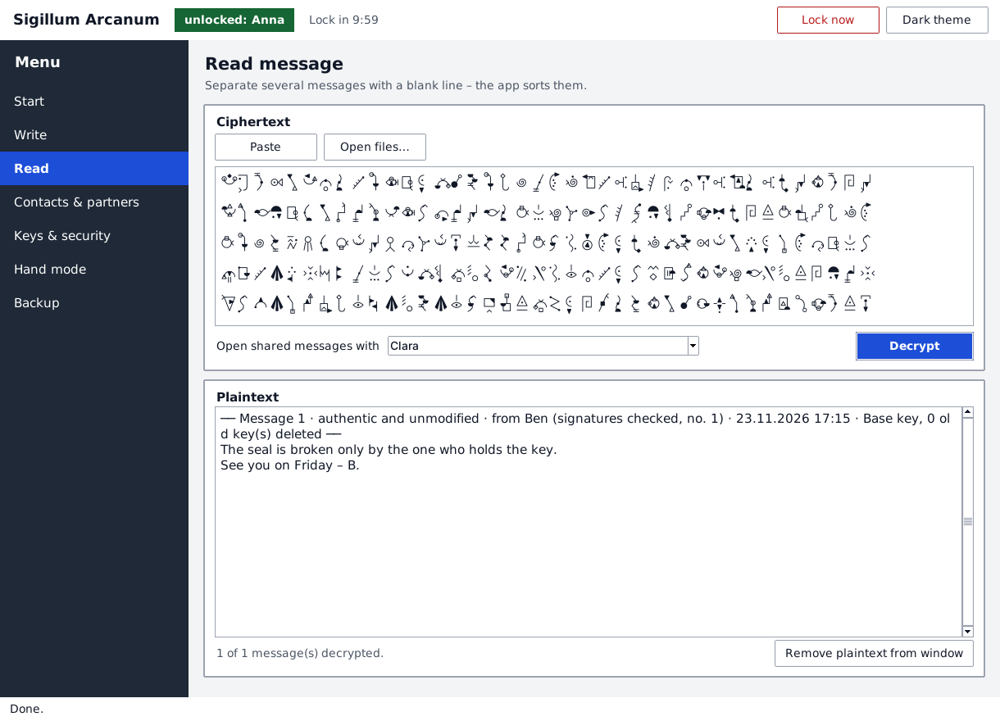
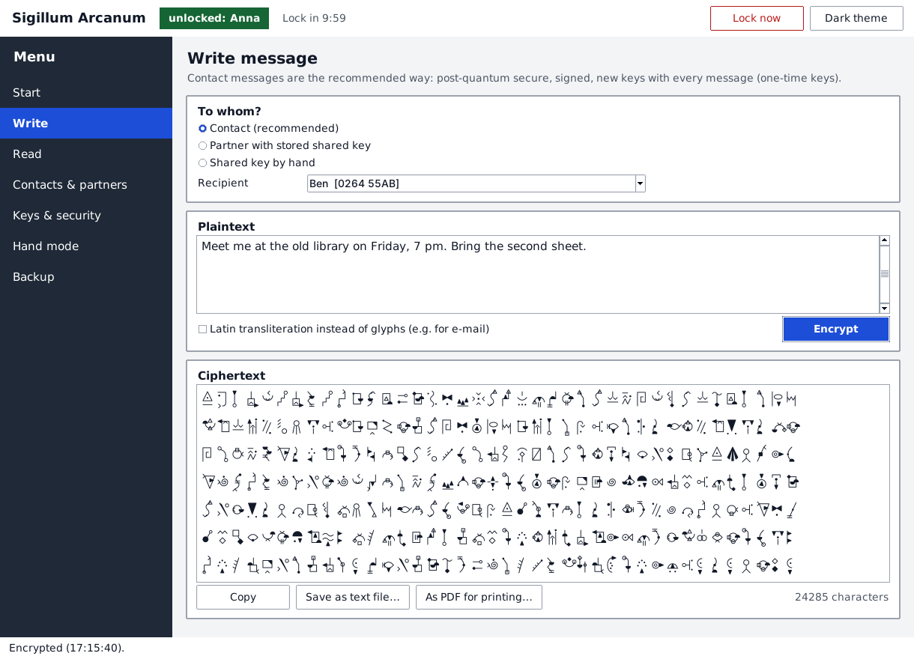
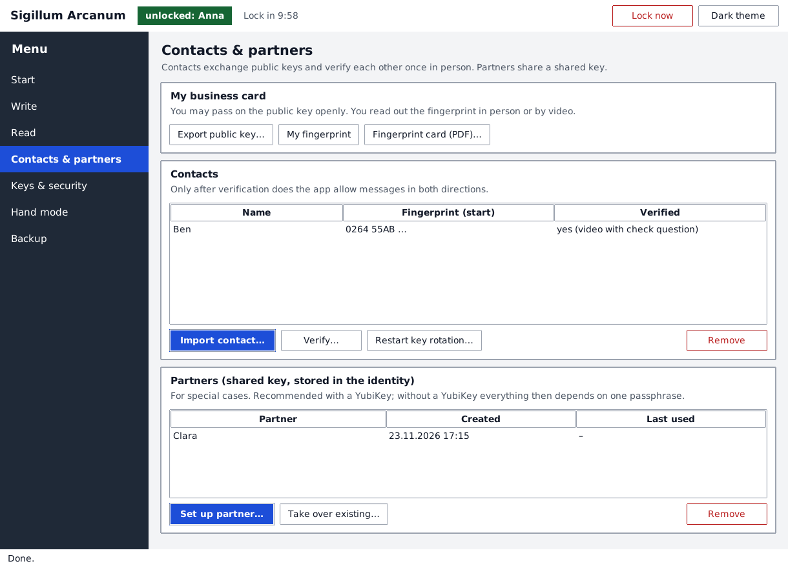
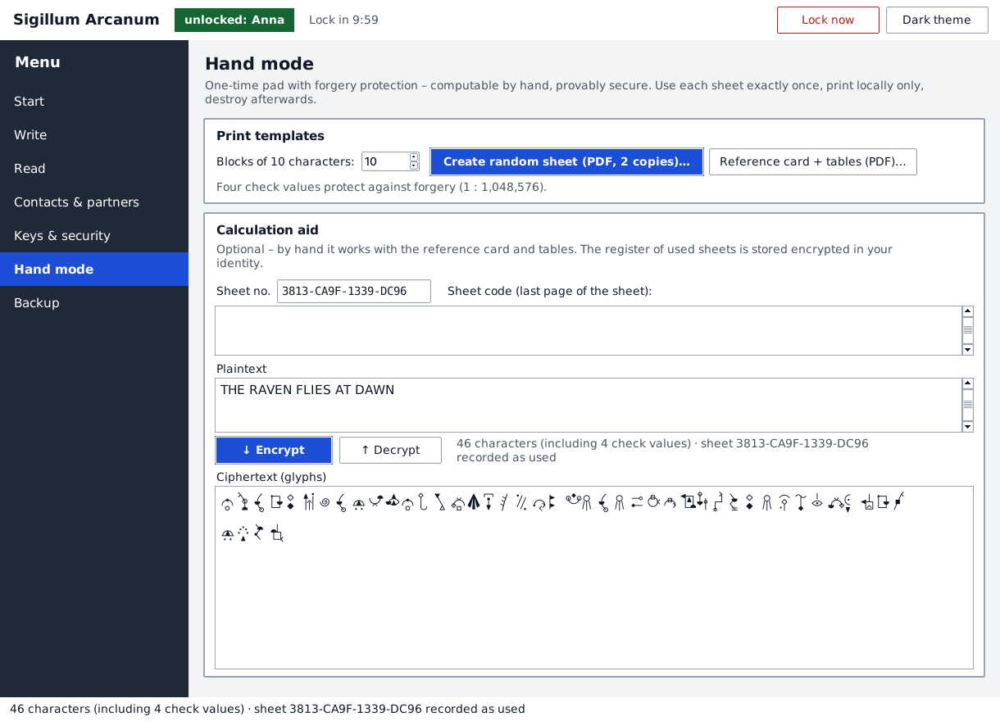
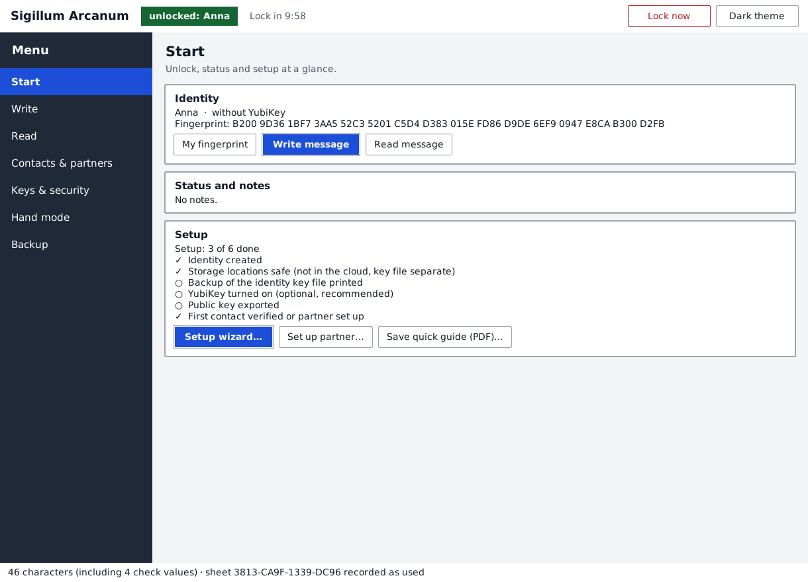
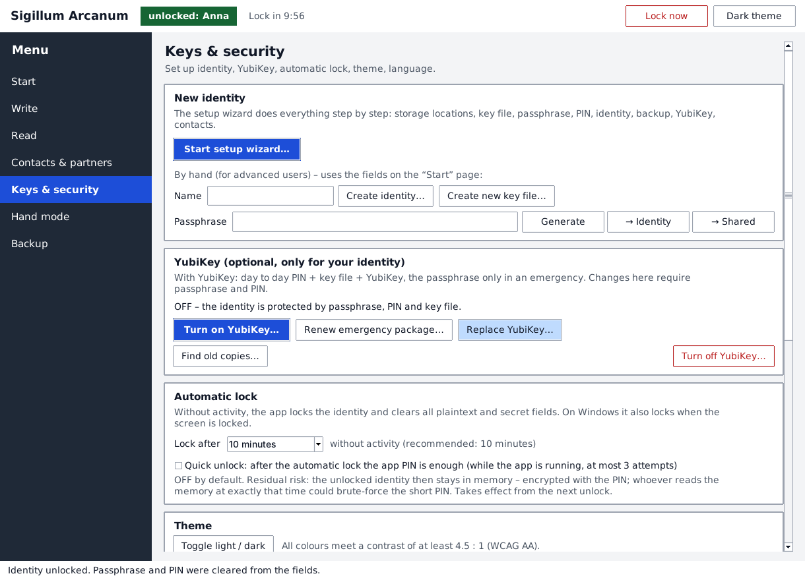
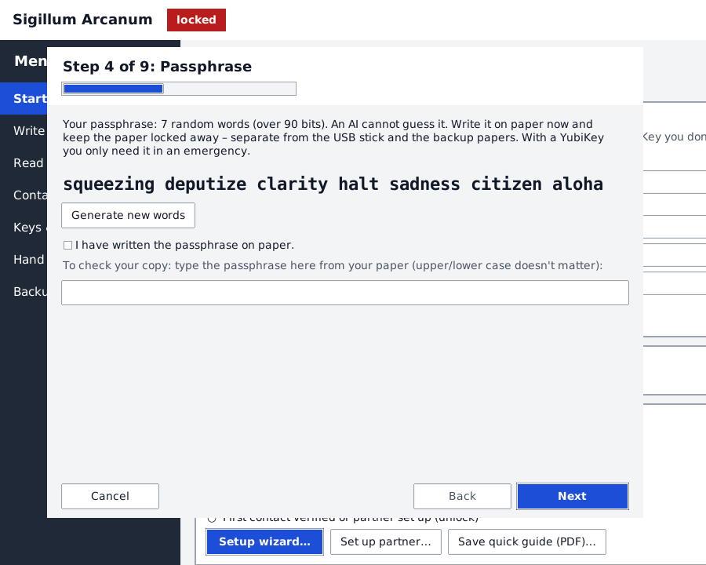
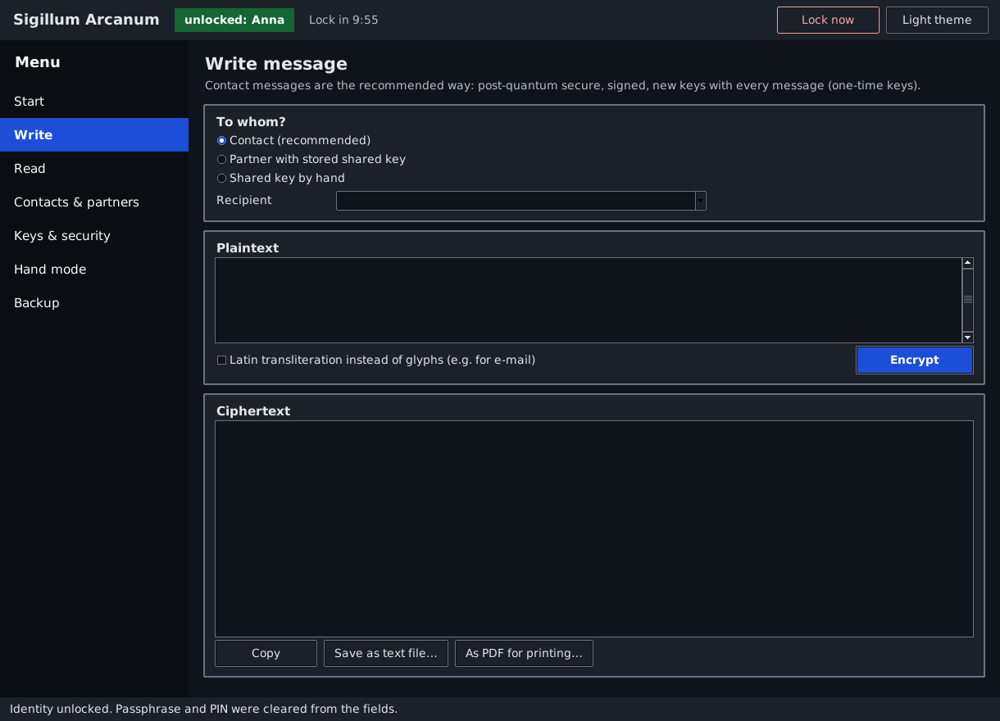
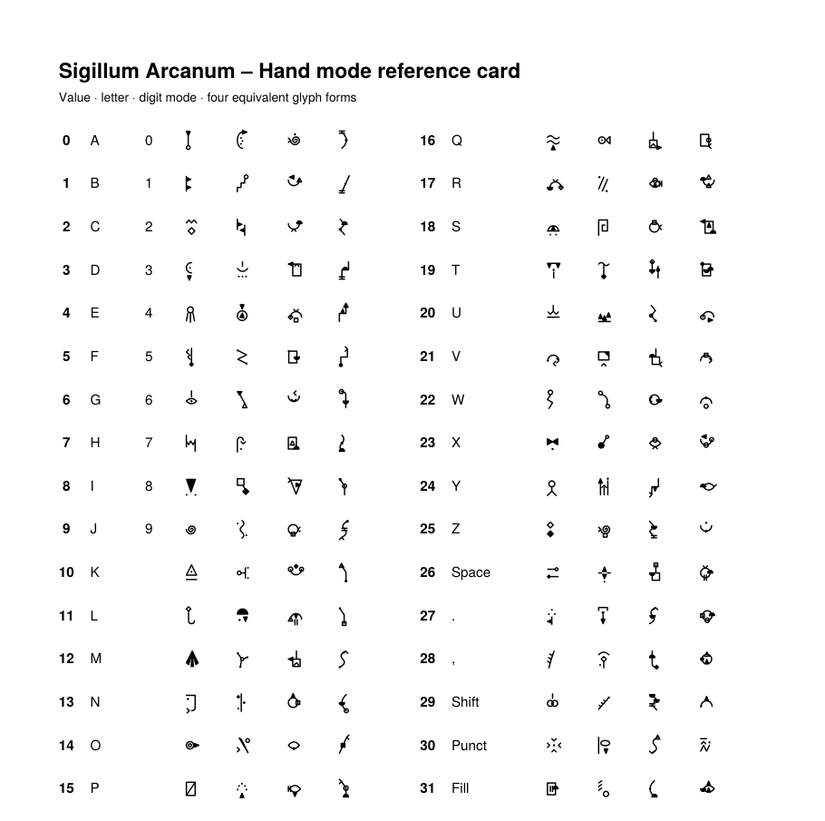

# Sigillum Arcanum

*The hidden script* – an offline encryption app for Windows with its own script, a hand cipher for pen and paper,
and hybrid post-quantum cryptography aligned with the German BSI TR-02102-1.

> **Status: experimental, not independently audited.**
> The code has been through repeated internal security reviews (see [`docs/SECURITY-REVIEW.md`](docs/SECURITY-REVIEW.md)),
> but no external audit. Do not rely on it where life, liberty or safety depend on secrecy.



## What it does

* **Own script.** Ciphertext is written in a custom font of 32 glyphs × 4 forms (5 bits per glyph), or as plain
  Base32 text for copy & paste.
* **Contacts (recommended).** Hybrid key exchange **ML-KEM-1024 + ECDH brainpoolP512r1** (combined per NIST SP 800-227),
  hybrid signatures **ML-DSA-87 + ECDSA-brainpoolP512r1-SHA3-512**. Every message announces a pool of fresh receive keys;
  one-time keys are deleted after reading (forward secrecy per message for up to four messages in a row).
* **Shared key.** For special cases: passphrase + PIN + key file, Argon2id (1 GiB, 4 passes).
* **Identity file** protected by passphrase, PIN and a separate key file (possession factor, e.g. on a USB stick);
  optionally a **YubiKey** (FIDO2 hmac-secret/PRF) so the passphrase can stay locked away in everyday use.
* **Emergency package.** Shamir 2-of-3 over a prime field (TR-02102-1 chapter 7) on three printable sheets.
* **Hand mode.** Encrypt and decrypt with pen and paper using one-time random sheets.
* **Hardening.** Auto-lock, optional quick unlock, rollback warning for restored identity files, clipboard clearing,
  cloud-folder warnings, start-up self test with known-answer vectors from independent implementations.
* **Offline by design.** No network access, no telemetry.
* **English and German.** On first start the app follows the Windows display language (German → German, anything
  else → English); switch any time under “Keys & security”.

Symmetric encryption throughout is **AES-256-GCM-SIV** (RFC 8452), key derivation **HKDF-SHA-512**, hashes **SHA-3**.
The full byte-level specification is in [`FORMAT.en.md`](FORMAT.en.md) (English) and [`FORMAT.md`](FORMAT.md) (German).

## Screenshots

All screenshots show the English interface; the app looks the same in German.

| | |
| --- | --- |
|  |  |
| **Write.** Choose a verified contact, type the message, encrypt. The ciphertext is shown in the app's own glyph script (or as Base32 for e-mail) and can be copied, saved or printed. | **Read.** Paste one or more messages; the app checks both signatures (classical and post-quantum), shows the sender and deletes receive keys that are no longer needed. |
|  |  |
| **Contacts & partners.** Exchange public keys and verify fingerprints once in person or by video. Partners with a shared key are stored encrypted inside your identity. | **Hand mode.** A one-time pad with forgery protection that also works with pen and paper. The app prints random sheets and keeps an encrypted register so no sheet is used twice. |
|  |  |
| **Start.** Unlock the identity, see its fingerprint, open notes and the setup checklist. | **Keys & security.** YubiKey on/off, emergency package, automatic lock, quick unlock, theme and language. |
|  |  |
| **Setup wizard.** Nine steps from storage locations to a printed backup – here the 7-word passphrase that you copy onto paper and type back to check. | **Dark theme.** Light and dark themes; all colours meet a contrast of at least 4.5 : 1 (WCAG AA). |



**Reference card for hand mode** (printed by the app): every value has a letter, a digit-mode meaning and four
interchangeable glyph forms, so the same letter never has to look the same twice.

## Installation (Windows 10/11)

Download the ZIP of the latest release from the [Releases](../../releases) page (check it against the attached
`.sha256`), or clone the repository. Changes per version: [`CHANGELOG.md`](CHANGELOG.md).

1. Install Python 3.11 or newer from <https://www.python.org/downloads/windows/>.
2. Run `installieren.bat`. It creates a virtual environment and installs pinned dependencies, each checked by
   SHA-256 hash, binary wheels only.
3. Start with `start.bat`. A setup wizard guides you through identity, key file, passphrase, PIN, backup and YubiKey.

User manual: [`MANUAL.md`](MANUAL.md) (English) · [`LIESMICH.md`](LIESMICH.md) (Deutsch).

## Threat model in brief

Protected: stolen laptop or USB stick alone, stolen identity file, recorded messages (including "harvest now,
decrypt later" against future quantum computers), tampered or replayed messages.

Not protected: malware on the running computer, a captured memory image while the app runs or after locking
(Python cannot reliably wipe memory), all factors stolen together, a coerced user. Details and remaining risks:
section 10 of the manual and [`docs/SECURITY-REVIEW.md`](docs/SECURITY-REVIEW.md).

## Tests

```bash
python -m pip install pytest
python -m pytest -q tests
```

The YubiKey is simulated in the automated tests (`tests/softtoken.py`). GUI end-to-end tests
(`tests/manual_gui_*.py`) need a display. The test suite runs in German by default (`tests/conftest.py`);
`tests/test_i18n.py` checks that the English catalog `sigillum/locale/en.json` is complete and consistent, and
`tests/manual_gui_en.py` walks the English interface looking for leftover German text. Known-answer vectors live in `tests/vectors/` and `sigillum/data/`;
all keys in them are test keys.

## Reporting security issues

Please see [`SECURITY.md`](SECURITY.md). Do not open public issues for vulnerabilities.

## License

Code, font and documentation: [Apache License 2.0](LICENSE). Third-party material and attributions: [`NOTICE`](NOTICE).

Standards used: FIPS 203, FIPS 204, NIST SP 800-227, RFC 8452, RFC 5869, RFC 5639, BSI TR-02102-1, WCAG 2.x.
